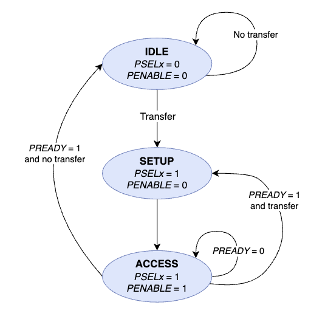
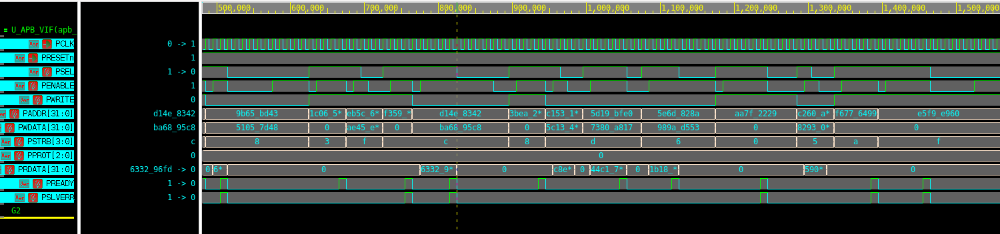
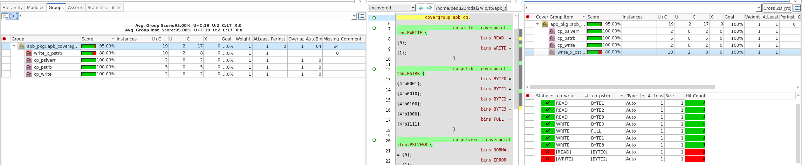
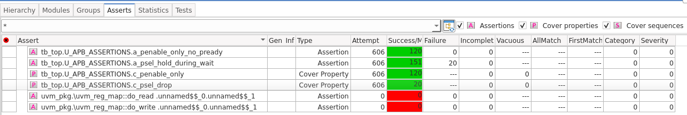

# APB_VIP_UVM

SystemVerilog/UVM 기반으로 구현한 **AMBA APB Verification IP(VIP)** 프로젝트입니다.

APB Master/Slave Agent를 구성하여 Read/Write Transaction을 생성하고,  
Monitor, Scoreboard, Assertion, Functional Coverage를 통해 APB Interface의 정상 동작과 Protocol Violation을 검증합니다.

---

## Overview

본 프로젝트의 주요 검증 목표는 다음과 같습니다.

- APB Read / Write Transaction 생성
- `SETUP → ACCESS` Protocol Timing 검증
- `PREADY` Wait State 처리
- Back-to-Back Transaction 지원
- Master / Slave Monitor Transaction 비교
- Scoreboard 기반 데이터 검증
- SystemVerilog Assertion(SVA) 기반 Protocol Check
- Functional Coverage 수집
- Negative Scenario 기반 Protocol Violation 검증

APB VIP는 단순히 신호를 발생시키는 Driver뿐 아니라, Transaction 생성부터 Monitor, Scoreboard, Assertion, Coverage까지 포함하는 재사용 가능한 검증 환경으로 구성했습니다.

| 항목 | 내용 |
|---|---|
| 기간 | 2026.08.13 ~ 2026.08.24 |
| 형태 | 개인 프로젝트 |
| 검증 | UVM 1.1d · SVA · Functional Coverage |
| 도구 | Synopsys VCS W-2024.09-SP2 · Verdi · urg |
| 관련 프로젝트 | [AXI4-Lite → APB Bridge UVM 검증](https://github.com/ky0nq/AXI4-Lite-to-APB_Bridge_UVM) |

## 핵심 결과

- Master / Slave Agent를 **Virtual Sequencer**로 묶어 하나의 Transaction을 Master · Slave Item으로 복사해 동시 구동 (Race Condition 방지)
- Slave Driver에서 **PREADY 0~5 cycle 랜덤 지연** · `PSLVERR` 응답, Back-to-Back 비율 70%
- `apb_basic_test`: Write 23 · Read 37, **Scoreboard PASS 60 / FAIL 0**, UVM_ERROR 0
- Functional Coverage(covergroup) **95.00%** · Negative Scenario Cover Property **2 / 2 Hit**

---

## APB Protocol

APB Transfer의 기본 흐름은 다음과 같습니다.

<p align="center">
  
</p>

### APB Signals

| Signal | Direction | Description |
|---|---|---|
| `PCLK` | Input | APB Clock |
| `PRESETn` | Input | Active-Low Reset |
| `PADDR` | Master → Slave | Address |
| `PSEL` | Master → Slave | Slave Select |
| `PENABLE` | Master → Slave | Access Phase |
| `PWRITE` | Master → Slave | Write / Read Select |
| `PWDATA` | Master → Slave | Write Data |
| `PSTRB` | Master → Slave | Write Byte Enable |
| `PPROT` | Master → Slave | Protection Attribute |
| `PRDATA` | Slave → Master | Read Data |
| `PREADY` | Slave → Master | Transfer Complete |
| `PSLVERR` | Slave → Master | Slave Error Response |

---

## UVM Architecture


### Verification Flow

```text
Sequence
   ↓
Sequencer
   ↓
Driver
   ↓
APB Interface
   ↓
Monitor
   ↓
Scoreboard / Coverage

APB Interface
   ↓
Assertion
```

---

## Directory Structure

```text
APB_VIP_UVM/
│
├── rtl/
│
├── tb/
│   ├── apb_if.sv
│   ├── apb_assertions.sv
│   ├── apb_coverage.sv
│   ├── apb_pkg.sv
│   │
│   ├── apb_seq_item.sv
│   │
│   ├── apb_master_sqr.sv
│   ├── apb_slave_sqr.sv
│   ├── apb_sequencer.sv
│   │
│   ├── apb_master_sequence.sv
│   ├── apb_slave_sequence.sv
│   ├── apb_sequence.sv
│   │
│   ├── apb_master_driver.sv
│   ├── apb_slave_driver.sv
│   │
│   ├── apb_master_monitor.sv
│   ├── apb_slave_monitor.sv
│   │
│   ├── apb_master_agent.sv
│   ├── apb_slave_agent.sv
│   │
│   ├── apb_scoreboard.sv
│   ├── apb_env.sv
│   ├── apb_test.sv
│   └── tb_top.sv
│
└── Makefile
```

---

## Transaction

`apb_seq_item`을 통해 APB Request / Response 정보를 전달합니다.

```systemverilog
rand bit [31:0] PADDR;
rand bit [31:0] PWDATA;
rand bit        PWRITE;
rand bit [3:0]  PSTRB;
rand bit [31:0] PRDATA;

rand bit          b2b;
rand int unsigned idle_cycles;
```

Negative Test를 위해 Scenario 정보도 함께 전달합니다.

```systemverilog
typedef enum {
    APB_NORMAL,
    APB_PENABLE_ONLY,
    APB_PSEL_DROP
} apb_scenario_e;
```

---

## Master Driver

Master Driver는 다음 APB Request Signal을 구동합니다.

```text
PADDR
PSEL
PENABLE
PWRITE
PWDATA
PSTRB
PPROT
```

Normal Transaction은 다음 흐름으로 수행합니다.

```text
IDLE
 ↓
SETUP
 ↓
ACCESS
 ↓
PREADY Wait
 ↓
Complete
```

Back-to-Back Transaction에서는 이전 ACCESS 완료 후 IDLE 상태 없이 바로 다음 SETUP으로 전환할 수 있습니다.

```text
ACCESS #1
PSEL=1 PENABLE=1 PREADY=1
          ↓
SETUP #2
PSEL=1 PENABLE=0
          ↓
ACCESS #2
```

---

## Slave Driver

Slave Driver는 다음 Response Signal을 구동합니다.

```text
PRDATA
PREADY
PSLVERR
```

`PREADY`를 랜덤한 Cycle 이후 발생시키도록 하여 Wait State를 생성하고,  
Master가 ACCESS Wait 동안 Request Signal을 유지하는지 검증할 수 있도록 구성했습니다.

---

## Monitor

Master Monitor와 Slave Monitor는 APB Interface를 관찰하여 Transaction을 생성합니다.

정상 Transaction의 기준은:

```text
SETUP
PSEL=1, PENABLE=0

        ↓

ACCESS Complete
PSEL=1, PENABLE=1, PREADY=1
```

입니다.

수집된 Transaction은 Scoreboard로 전달됩니다.

---

## Scoreboard

Master Monitor와 Slave Monitor에서 수집한 Transaction을 각각 Queue에 저장한 뒤 동일 순서로 비교합니다.

```text
Master Monitor ──→ master_q ──┐
                              ├── Compare
Slave Monitor  ──→ slave_q  ──┘
```

### Request Check

```text
PADDR
PWRITE
PSTRB
PPROT
```

### Write Check

```text
PWDATA
PREADY
PSLVERR
```

### Read Check

```text
PRDATA
PREADY
PSLVERR
```

최종적으로 다음 결과를 출력합니다.

```text
========================================
         APB SCOREBOARD RESULT
========================================
    Write Count
    Read Count
    Pass Count
    Fail Count
========================================
```

---

## Negative Protocol Verification

정상 APB Transaction뿐 아니라 일부 Scenario에서 의도적으로 Protocol을 위반하여 Assertion이 해당 오류를 검출하는지 확인합니다.

현재 구현한 주요 Negative Scenario는 다음과 같습니다.

### PENABLE_ONLY

의도적으로 다음 상태를 생성합니다.

```text
PSEL    = 0
PENABLE = 1
```

본 VIP에서는 선택되지 않은 Slave가 `PREADY`를 응답하지 않는 정책을 적용했습니다.

```systemverilog
(!PSEL && PENABLE) |-> !PREADY;
```

Expected:

```text
PSEL    = 0
PENABLE = 1
PREADY  = 0
```

---

### PSEL_DROP

ACCESS Wait 상태에서 의도적으로 `PSEL`을 LOW로 변경합니다.

```text
ACCESS WAIT

PSEL       1 ───────── 0
PENABLE    1 ───────── 1
PREADY     0 ───────── 0
                      ↑
                  PSEL DROP
```

ACCESS가 완료되지 않은 상태에서는 `PSEL`이 유지되어야 하므로 Assertion으로 검출합니다.

```systemverilog
(PSEL && PENABLE && !PREADY)
|=> PSEL;
```

---

## Assertions

`apb_assertions.sv`는 APB Interface Signal을 Clock 단위로 직접 감시하여 Protocol Rule을 검사합니다.

현재 주요 Assertion:

```text
a_penable_only_no_pready
└─ PENABLE_ONLY 상태에서 PREADY가 발생하지 않는지 확인

a_psel_hold_during_wait
└─ ACCESS Wait 중 PSEL이 유지되는지 확인
```

Negative Scenario가 실제 발생했는지는 `cover property`로 확인합니다.

```text
c_penable_only
c_psel_drop
```

예를 들어 PSEL_DROP 검증에서는:

```text
c_psel_drop HIT
        +
a_psel_hold_during_wait FAIL
        ↓
PSEL_DROP Scenario 발생 및 Protocol Violation 검출
```

형태로 확인할 수 있습니다.

---

## Functional Coverage

`apb_coverage.sv`에서는 정상 APB Transaction을 기반으로 Functional Coverage를 수집합니다.

### Read / Write Coverage

```systemverilog
cp_write : coverpoint item.PWRITE {
    bins READ  = {0};
    bins WRITE = {1};
}
```

### PSTRB Coverage

```systemverilog
cp_pstrb : coverpoint item.PSTRB {
    bins BYTE0 = {4'b0001};
    bins BYTE1 = {4'b0010};
    bins BYTE2 = {4'b0100};
    bins BYTE3 = {4'b1000};
    bins FULL  = {4'b1111};
}
```

### PSLVERR Coverage

```systemverilog
cp_pslverr : coverpoint item.PSLVERR {
    bins NORMAL = {0};
    bins ERROR  = {1};
}
```

### Cross Coverage

```systemverilog
write_x_pstrb : cross cp_write, cp_pstrb;
```

Negative Scenario는 정상 Transaction Monitor를 통해 수집되지 않을 수 있으므로 `cover property`를 이용하여 별도로 Coverage를 확인합니다.

---

## Verification Components

| Component | Role |
|---|---|
| Sequence | Transaction 및 Scenario 생성 |
| Sequencer | Sequence Item 전달 |
| Master Driver | APB Master Signal 구동 |
| Slave Driver | APB Slave Response 구동 |
| Monitor | APB Transaction 관찰 |
| Scoreboard | Master / Slave Transaction 비교 |
| Assertion | Protocol Rule 및 Violation 검출 |
| Functional Coverage | 정상 Transaction Coverage 수집 |
| Cover Property | Negative Scenario 발생 여부 확인 |

---

## Verification Scenarios

| Scenario | Type | Description |
|---|---|---|
| `NORMAL` | Normal | APB Read / Write |
| `WAIT_STATE` | Normal | `PREADY=0` 동안 ACCESS 유지 |
| `BACK_TO_BACK` | Normal | IDLE 없이 연속 Transaction 처리 |
| `PENABLE_ONLY` | Negative | `PSEL=0`, `PENABLE=1` 상태 생성 |
| `PSEL_DROP` | Negative | ACCESS Wait 중 `PSEL` Drop |

---

## Simulation Results

### Waveform



### Coverage



### Assertion



---

## Simulation Environment

| Item | Tool |
|---|---|
| Language | SystemVerilog |
| Verification | UVM |
| Simulator | Synopsys VCS |
| Waveform | Verdi / FSDB |
| Coverage | VCS Coverage / URG |
| Protocol | AMBA APB |

---

## Run

### Compile

```bash
make sim
```

VCS Compile 및 Elaboration을 수행합니다.

### Simulation

```bash
make run
```

기본 Test:

```text
apb_basic_test
```

Verbosity를 변경할 수 있습니다.

```bash
make run TEST=apb_basic_test VERBOSITY=UVM_HIGH
```

### Waveform

```bash
make wave
```

Simulation 수행 후 `wave.fsdb`를 Verdi에서 확인합니다.

### Coverage Report

```bash
make cov
```

Coverage DB를 생성한 뒤 URG Report를 생성합니다.

```text
coverage.vdb
      ↓
     URG
      ↓
coverage_report/
```

### Coverage GUI

```bash
make cov_wave
```

Coverage 결과를 Verdi에서 확인합니다.

### Clean

```bash
make clean
```

Simulation / Waveform / Coverage 생성 파일을 삭제합니다.

---

## Verification Strategy

본 프로젝트에서는 검증 역할을 다음과 같이 분리했습니다.

```text
Scoreboard
    → Transaction Data Correctness

Assertion
    → Protocol Rule / Violation Detection

Functional Coverage
    → Normal Transaction Coverage

Cover Property
    → Negative Scenario Occurrence
```

---

## References

- ARM AMBA APB Protocol Specification
- Universal Verification Methodology (UVM)

### Repository

https://github.com/ky0nq/APB_VIP_UVM
